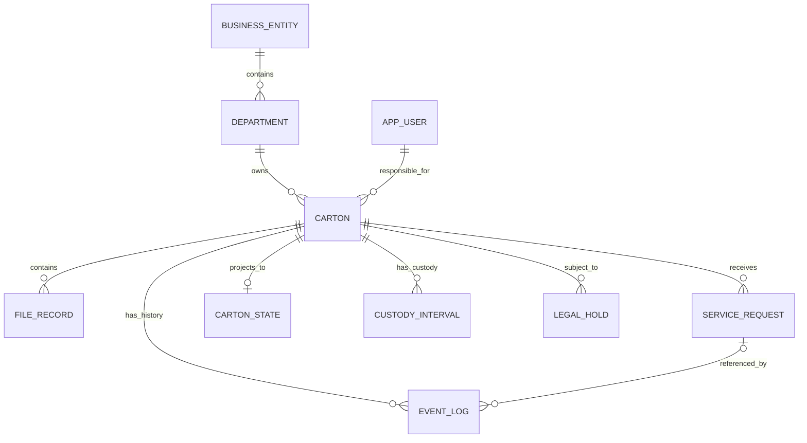
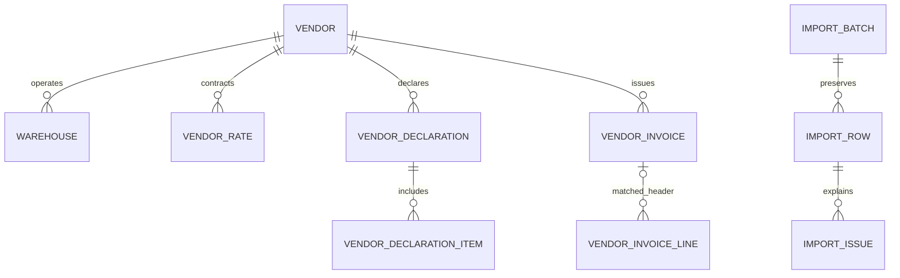
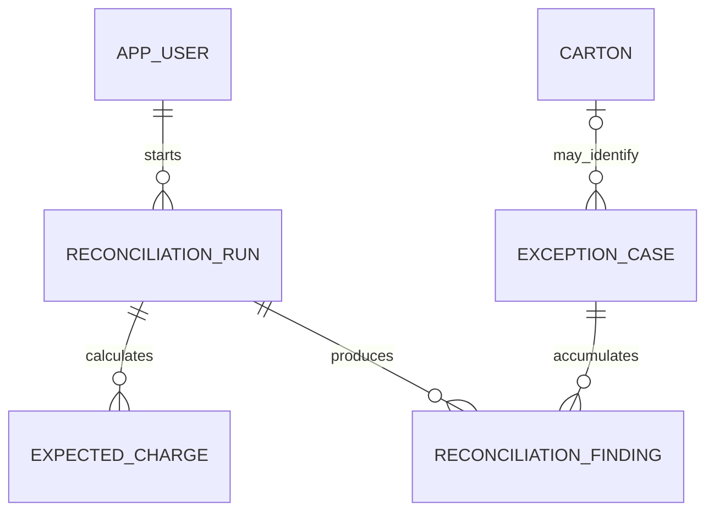

# PRMS database design

Version 1 · 10 October 2026 · PostgreSQL 16+ recommended

This package turns the supplied Physical Records Management System brief, workbook and synthetic retention policy into an implementable relational schema. It is a database foundation, not a finished backend. It includes 37 tables, a derived retention view, reference seeds, append-only protection, indexes and rollback-only constraint checks.

## Files and setup

| File | Purpose |
|---|---|
| `01_schema.sql` | Tables, constraints, indexes, evidence protection and retention view |
| `02_seed_reference.sql` | Reference data extracted from the supplied workbook; no passwords or operational data |
| `03_runtime_grants.sql` | Privilege template for an existing non-owner backend database login |
| `04_constraint_checks.sql` | Synthetic test fixtures; all changes rolled back |
| `COLUMN_DICTIONARY.md` | Every column and its PostgreSQL definition |
| `../mermaid/00_complete_schema.mmd` | Complete Mermaid relationship diagram |
| `VALIDATION.md` | Actual validation results and limitations |

Run against a new development database. The schema script intentionally fails if `prms` already exists: it is an initial migration, not a destructive reset script. Subsequent changes should use Alembic migrations.

```bash
psql "$PRMS_DATABASE_URL" -v ON_ERROR_STOP=1 -f sql/01_schema.sql
psql "$PRMS_DATABASE_URL" -v ON_ERROR_STOP=1 -f sql/02_seed_reference.sql
psql "$PRMS_DATABASE_URL" -v ON_ERROR_STOP=1 -f sql/04_constraint_checks.sql
# Provision a separate non-owner login securely before this optional step:
psql "$PRMS_DATABASE_URL" -v ON_ERROR_STOP=1 -v runtime_role=prms_app -f sql/03_runtime_grants.sql
```

`PRMS_DATABASE_URL` for migrations belongs to a deployment owner. Runtime credentials must belong to a different non-owner, non-superuser login with no ability to become the owner, create objects, disable triggers, or change grants. Do not put credentials into the repository. `btree_gist` must be available on the PostgreSQL server. The grant script uses psql variable substitution, so it is not directly executable as an ORM migration.

## Design decisions

1. **One event authority.** `event_log` is the only canonical business-event history. Cartons, requests, holds, custody intervals and current state are projections or reference/master data. Before/after payloads make metadata and reference changes auditable. There is no competing `audit_log` table.
2. **Custody differs from workflow status.** A carton in `Destruction Requested` may still be physically in `WAREHOUSE` custody. Billing uses custody intervals, not an equality test on status.
3. **Vendor claims remain evidence.** Unknown carton references, duplicate lines, wrong rates and inconsistent certificates must be queryable. Vendor evidence tables deliberately do not enforce operational carton foreign keys or uniqueness that would erase the anomaly.
4. **Strict live records; lossless imports.** Invalid historical records remain in `import_row` with issues and linked exception evidence. Never modify the workbook to make it fit constraints. No silent dropping, reclassification, deletion or fabricated history.
5. **Reference-driven calculations.** Policy lookup drives destruction dates; effective-dated rates drive expected charges. Thresholds and holidays remain data. Missing rules produce incomplete-calculation findings, not guessed values.
6. **A manageable monolith.** Use one PostgreSQL database and a conventional service layer. No message broker, partitioning or event-store product is required for the supplied dataset.

## Core relationships



Optionality matters: a newly staged carton may not have a projection yet, but a committed live creation must have its creation event and state. Events such as holds do not need requests. The event log also supports reference/user/certificate/exception/reconciliation streams without a carton FK.



An invoice line may have no resolved header because its source reference is orphaned or ambiguous. Certificate evidence is one row per declared carton; repeated certificate IDs are not automatically duplicates.



## Table catalogue

IDs such as `CTN-000001`, `REQ-000001`, `USR-0001` remain text to preserve source identifiers. Internal identities use generated `bigint`. Dates use `date`; actual instants use `timestamptz`; money uses `numeric`, never floating point.

| Group | Table | Primary key | Purpose |
|---|---|---|---|
| Organization | `business_entity` | `entity_id` | Three entity groups |
| Organization | `department` | `department_id` | Department ownership with entity validation |
| Organization | `vendor` | `vendor_id` | Vendor identity and contract metadata |
| Organization | `warehouse` | `location_id` | Warehouse belongs to one vendor |
| Identity | `app_user` | `user_id` | One role and valid scope; inactive users retain authorship |
| Identity | `user_session` | `token_hash` | Hashed session tokens, expiry and revocation |
| Reference | `document_type` | `document_type` | Classification and trigger description |
| Reference | `archival_policy` | `archival_policy` | Standard / Country Specific / Banking |
| Reference | `retention_policy` | `policy_id` | Current effective retention years; optional entity override |
| Reference | `vendor_rate` | `rate_id` | Non-overlapping vendor/activity date ranges |
| Reference | `sla_rule` | `sla_rule_id` | Activity timing definition; optional vendor override |
| Reference | `holiday` | `holiday_date` | Supplied business-day exclusions |
| Reference | `threshold_rule` | `threshold_id` | Configurable calendar/business-day findings |
| Reference | `tax_rule` | `tax_rule_id` | Configured tax rate and coverage period |
| Reference | `carton_status` | `status_code` | Supplied status vocabulary |
| Reference | `event_type` | `event_type` | Source vocabulary plus documented audit extensions |
| Reference | `lifecycle_transition` | from status + event | Allowed live workflow changes |
| Import | `import_batch` | `batch_id` | Original artifact hash, source, uploader and timezone |
| Import | `import_row` | `row_id` | Exact source row and location; duplicates remain visible |
| Import | `import_issue` | `issue_id` | Row-specific rejection/warning/deduplication reason |
| Record | `carton` | `carton_id` | Ownership and classification projection; no due-date input |
| Record | `file_record` | `file_id` | File metadata; type must match its operational carton |
| Workflow | `service_request` | `request_id` | Request and approval projection; SLA definition snapshot |
| Evidence | `event_log` | `event_id` | Immutable, ordered, idempotent business evidence |
| Projection | `carton_state` | `carton_id` | Current workflow status, custody, warehouse and version |
| Projection | `custody_interval` | `interval_id` | Non-overlapping historical custody periods |
| Projection | `legal_hold` | `hold_id` | Apply/release interval linked to evidence events |
| Vendor evidence | `vendor_declaration` | `declaration_id` | Vendor, cycle and exact declared timestamp |
| Vendor evidence | `vendor_declaration_item` | `declaration_item_id` | Raw carton/location claims |
| Vendor evidence | `vendor_invoice` | `invoice_record_id` | Header as received; claimed totals remain unchanged |
| Vendor evidence | `vendor_invoice_line` | `invoice_line_id` | Lines including duplicates/orphans and claimed rates |
| Vendor evidence | `certificate_evidence` | `certificate_row_id` | One carton claim per certificate evidence row |
| Reconciliation | `reconciliation_run` | `run_id` | Who ran what, cutoff, fingerprint, rules and results |
| Reconciliation | `expected_charge` | `expected_charge_id` | Immutable independent charge calculation for a run |
| Reconciliation | `exception_case` | `exception_id` | Single register, stable identity, owner, visibility and aging |
| Reconciliation | `reconciliation_finding` | `finding_id` | Run-specific observation linked to an exception |
| Notification | `alert` | `alert_id` | Deduplicated retention and overdue alerts |

See `COLUMN_DICTIONARY.md` for every field. Do not build all screens before proving the core lifecycle. The supporting tables are small and logically separate to avoid duplicating responsibilities.

## Event contract and projections

Required event information: event type, stream, subject carton where applicable, occurrence time, recorded time, actor identity/reference, actor role snapshot, request where applicable, channel, immutable payload, source provenance, and idempotency key. `corrects_event_id` supports compensating evidence; it never permits an UPDATE.

`payload` is not arbitrary storage for the entire application. Validate each event against a versioned backend schema. Minimum payloads:

| Event family | Payload requirements |
|---|---|
| Carton creation | Complete initial ownership, classification, trigger, vendor and barcode snapshot |
| Metadata/file indexing | Before/after metadata; file ID and permitted field values; reason |
| Request | Type, carton, destination, vendor, requester, rule snapshot |
| Collection/receipt/delivery | Actual custody transition, warehouse/vendor or destination, confirmation evidence |
| Hold | Hold ID, matter, reason, owner, start/release precision and release reason |
| Approval/destruction | Request, approver, checked policy ID/revision, due date, hold decision, physical execution details |
| Certificate lodging | Certificate reference and rows or source-row references; evidence stream, not carton movement |
| Reference/user changes | Object ID, before/after values, actor, reason; never include password hashes or session tokens |
| Correction | Original event ID, reason, replacement facts and authorized reviewer |

Live commands must append events and update projections in the SAME database transaction. The DDL does not contain a complete reducer: the team must implement and test it. Event order is `(occurred_at, event_id)`; `event_id` alone is not historical order. `stream_version` protects append concurrency. For backdated imported evidence, rebuild the affected projection before allowing new commands. A conflicting same-time historical sequence must be flagged rather than silently given invented temporal certainty.

Hold/acknowledgment events can have `resulting_status = NULL`; retain the previous status while still updating event/version pointers. Custody intervals change only on actual movement, not on request submission, approval, or holds. `state_since` changes only when workflow state changes; it is not the time of every last event.

Corrupt historical transitions stay available in evidence and produce exceptions. Do not resurrect a destroyed carton merely because a later corrupt source row supplies another status. The reducer applies the terminal-state rule, records the contradiction and exposes the original event. A truly unresolved history should block live actions until reviewed.

Current retention is derived from current carton classification and the current applicable policy. Original approval events retain the policy snapshot used at that time. Historical audits use those snapshots/configuration events rather than applying today's policy retroactively without explanation.

## Transaction pattern: destroy a carton

1. Authenticate the user and check they are active on this request; confirm own vendor scope.
2. Begin a transaction and lock the carton row (`SELECT ... FOR UPDATE`). All hold, custody and destruction commands must take this SAME lock in the same order.
3. Look up the idempotency key. If already committed for the same operation and payload, return the original result. Reusing a key for different input is an error.
4. Read current state and approved request. Verify request-carton-vendor agreement, independent Compliance approval, correct workflow state and physical warehouse custody.
5. Recompute retention using the policy view. Refuse missing trigger/rule or unexpired retention. Recheck all applicable holds from the hold projection/evidence, not a client flag or cached count alone.
6. Append the `DESTROYED` event with the next stream version. Close warehouse custody, write terminal state, and update the request projection.
7. Record certificate evidence in the same command when available. Later lodging uses a certificate stream, preserves the original execution date and never changes carton custody. This distinction must be confirmed because source wording about terminal events and later certification is inconsistent.
8. Commit atomically. On any error, roll back everything. Return a clear reason, including hold matter reference/owner where permitted.

The same locking discipline prevents a hold from arriving between destruction validation and commit. Database constraints alone do not implement this business transaction. Do not expose arbitrary event insertion or status PATCH endpoints.

## Authorization

This version uses backend authorization, not PostgreSQL row-level security. All application users access the API, never the database. Every list/detail/export/action applies row and field filters. An optional later RLS layer must be designed with authenticated identity propagation; setting an arbitrary user-ID session variable is not sufficient security.

| Application role | Scope and allowed work |
|---|---|
| BUSINESS | Own entity+department cartons; register/index; raise allowed requests |
| VENDOR | Own assigned requests and operational metadata only; acknowledge/confirm; no contents or financial data |
| COMPLIANCE | Cross-entity holds and independent destruction approvals; history read-only |
| FACILITIES | Cross-entity monitoring, reconciliation, user administration and permitted reference maintenance |

The `app_user` CHECK enforces valid scope shape. It does not ensure a carton owner is an active Business user of the same department; that is a live service check. Historical user-role changes must not rewrite stored actor-role snapshots. Deactivate identities, do not delete them. Login requires a non-null hash and active user, even though source identities can be imported without credentials.

Vendor exception ownership is separate from visibility. Financial findings default to Facilities visibility even when Vendor is the accountable owner. Use a redacted vendor projection only after requirements authorize one. Sensitive names/file metadata are masked by default, omitted from vendor responses, and excluded from operational logs.

Reference-policy editing authority is unresolved: the policy names the Records Management Office, but there are only four login roles. Do not give all reference mutation permissions to every Facilities endpoint simply because the backend database login can execute UPDATE.

## Reconciliation and billing

### Inventory

For each declaration, reconstruct warehouse custody at its exact `declared_at`, not the cycle's quarter-end or today's status. Compare matching vendor/location pairs with the unaltered declaration items. Produce matched, missing-at-vendor, unknown-to-us and wrong-location results. An unknown carton remains a vendor claim; never create a carton master merely to satisfy it.

### Invoice

First check header/line counts, quantities, arithmetic, subtotal, tax and total. Then independently calculate expected storage/activity from custody/events and requests. Compare actual lines to that result, including duplicate activity, multi-month storage quantity, unknown instructions, over/undercharge and storage after destruction.

Rates use half-open ranges `[effective_from, effective_to)`. A workbook end date of `2026-03-31` becomes `2026-04-01` exclusive. For storage choose the rate valid on the first day of the service month; for activity choose the execution/service date rate. Never use today's rate for an old bill. Missing return rates remain NULL with `MISSING_RATE`, not zero and not a substituted pickup rate.

Provisional billing assumption: one storage unit per carton/vendor/month when valid warehouse custody overlaps that month, with no daily proration. Repeated same-vendor intervals must be deduplicated before charging. Inter-vendor transfers or ambiguous partial-month terms need contractual clarification. Snapshot department allocation from the event-derived ownership applicable to the charge.

Expected charges are immutable per run and keep rate IDs plus applied rate/amount snapshots, so later edits do not rewrite past reconciliation evidence. Tax is 18% in the supplied policy; the seed intentionally leaves tax effective dates unconfigured because none are specified. Configure approved coverage explicitly and preserve the tax snapshot in `rule_snapshot`. Use decimal math and document rounding once at subtotal-tax calculation.

### Certificates

Join certificate rows to carton history, approved requests and historical hold intervals. Detect held destruction, missing evidence, certificate without destruction, post-destruction physical activity, reused reference across vendors/months and date disagreement. Repeated certificate reference for multiple cartons in a legitimate batch is normal. The evidence table intentionally permits conflicting dates/vendor references so these failures can be detected. The live certificate endpoint must prevent prohibited reuse before inserting new claims.

Date-only destruction claims compare against the event's India-local date, not its UTC calendar date. Source date-only holds cannot establish ordering within a day: report ambiguous same-day hold/release/destruction comparisons and block unsafe live destruction pending clarification rather than asserting a precise historical violation.

### Run identity and exception continuity

`input_fingerprint` hashes relevant artifact hashes, cutoff, engine version and rule snapshots. Same kind+scope+fingerprint returns the existing run; no duplicate job or findings. Changed evidence/rules produce a new identifiable run. Failed-run retries must explicitly reset/resume the same job or use a documented attempt strategy, never leave half-persisted findings masquerading as a completed run.

Stable exception keys identify a business disagreement across runs:

- Inventory: `MISSING_AT_VENDOR|VND-001|CTN-000001`, without quarter or run ID.
- Invoice: `RATE_MISMATCH|VND-001|invoice-business-key|line-business-key`; use source-row identity too if duplicate line numbers make the key ambiguous.
- Certificate: `CERT_VENDOR_REUSE|certificate-reference`, with all conflicting rows as evidence.
- Missing trigger: `MISSING_TRIGGER|carton-id`.

Use UPSERT by stable key. Preserve first discovery and first observation; advance last observed cutoff with `GREATEST` so running an older cycle cannot make a case younger. Each run adds an immutable `reconciliation_finding`. Resolve only when the applicable comparison scope has been fully checked or a reviewer records a justified resolution. Reappearance reopens the case with an event; a recurring episode can use a documented episode suffix if the product requires distinct cases.

## Workbook-to-database mapping

| Workbook sheet | Destination / handling |
|---|---|
| README, data_dictionary, column_dictionary | Import raw for provenance; interpret mappings in code, not as business records |
| ref_entities_departments | Split into `business_entity` and `department` |
| ref_users_roles | `app_user`; map source role IDs; `ALL`/`EXTERNAL` become NULL scope columns, not fake entities |
| ref_roles | Preserve raw; four permitted application role codes live in CHECK constraints |
| ref_vendors | `vendor` |
| ref_warehouse_locations | `warehouse`; accommodate stale `ref_locations` dictionary alias |
| ref_document_types | `document_type` |
| ref_retention_policy | `archival_policy`, `retention_policy`; supplied global defaults, no invented entity overrides |
| ref_rate_card | `vendor_rate`; normalize activities and inclusive end dates |
| ref_sla | `sla_rule`; seed supplied definitions, including approval-to-certificate destruction rule |
| ref_holiday_calendar | `holiday`; preserve coverage gaps |
| ref_threshold | `threshold_rule`; workbook values are calendar-day thresholds |
| ref_carton_status | `carton_status`; transitions explicitly mapped, not parsed ad hoc at runtime |
| ref_request_status | `service_request.request_status` constrained vocabulary; preserve descriptions raw |
| ref_event_type | `event_type`; supplied types plus documented application audit extensions |
| carton_inventory | `carton`; imported current status/location/hold flag are comparison evidence, not authority |
| file_index | `file_record`; mismatched/duplicate IDs remain raw with issues rather than failing the whole batch |
| requests | `service_request` where valid; preserve failed checks raw and report |
| event_log | `event_log`; original event ID in `source_event_id`, original actor reference retained |
| legal_holds | `legal_hold` projection reconciled with hold events; gaps require explicit provenance-bearing migration evidence |
| vendor_recertification_feed | `vendor_declaration`, `vendor_declaration_item` |
| vendor_invoices | `vendor_invoice` |
| vendor_invoice_lines | `vendor_invoice_line`; actual months such as Jan-2026 normalized to first-of-month date |
| destruction_certificates | `certificate_evidence`; do not impose unique certificate ID |

### Operational importer implementation order

1. Hash artifact; create/reuse `import_batch`; preserve every populated source row as JSON with sheet/row number and original value/type representation. Preserve exact original bytes externally at `artifact_uri` or via the supplied original file.
2. Seed references and users (already seeded references must be matched, not duplicated). Bootstrap uploader may be NULL for the first controlled migration.
3. Load valid carton/file/request metadata. Resolve duplicate identifiers explicitly; report conflicting values. A source inconsistency must not cause an entire workbook rollback.
4. Load canonical events in occurred-time order with stable import idempotency keys. Invalid orphan references remain raw; use a null canonical request link plus original reference in the payload only when its carton event is otherwise safely attributable.
5. Reconcile hold rows with existing hold events; do not double-create matching holds. Missing event evidence can be appended as explicitly labelled migration events citing the source row, with `recorded_at` now and source date precision; do not pretend a named person executed an action at a fabricated time. Keep unknown authorship visible.
6. Replay to rebuild state, requests, custody and holds. Compare supplied cached values; emit differences to the single exception register.
7. Load vendor evidence without repairing it to match internal records.
8. Report source rows = accepted/mapped + rejected/retained + explicitly reported duplicates, per sheet. Preserve issue evidence and expose it in Facilities views. Header/blank-row rules must be explicit.

`02_seed_reference.sql` is a reference seed, NOT this full operational importer. The initial canonical carton creation snapshot may need an explicitly labelled migration baseline from source metadata because historical events do not carry every creation field. Do not claim it proves historical metadata values that were not supplied.

## Rules enforced where

| Rule | Database DDL | Service/import responsibility |
|---|---|---|
| One valid user scope | CHECK + foreign keys | Role changes, active user check, endpoint permissions |
| Carton belongs to valid department/entity | Composite FK | Owner belongs to department and can perform action |
| File type matches carton | Composite FK | Preserve mismatched historical rows as evidence |
| Requester differs from approver | CHECK | Approver is active Compliance; requester was authorized Business |
| Rates/custody do not overlap | Exclusion constraints | Pick correct rate/custody boundary; handle incomplete history |
| Evidence is append-only | UPDATE/DELETE/TRUNCATE triggers + restricted runtime grants | Authorized inserts, immutable payload semantics, backup protection |
| Duplicate event retries | Unique idempotency key | Same key must mean same payload/operation; return original outcome |
| Request event matches carton | Composite FK | Required request type, vendor and event semantics |
| Event/projection consistency | Transaction capability and source links | Implement reducer and lock discipline; DDL does not auto-project |
| Live legal hold blocks destruction | Evidence/projection structure | Check under same carton lock at request/approval/execution |
| No physical action after destruction | Transition data has no outgoing terminal movement | Refuse command; preserve/report historical invalid events |
| Retention changes recompute dates | `carton_retention` view | Reevaluate/deduplicate alerts and audit policy edits |
| Vendor sees no costs/content | No direct user SQL access | Row/field-scoped API and export serializers |
| Recon reruns idempotent | Run/finding/case uniqueness | Correct fingerprint, stable keys, atomic completion and aging |
| Certification consistency | Lossless evidence, indexed references | Live validation and historical reconciliation |

Evidence triggers cannot protect against a database superuser or owner disabling them. Keep owner credentials out of runtime and back up the database. This is append-only application evidence, not cryptographic tamper-proof storage.

## Open decisions and conservative defaults

- **Team stack:** PostgreSQL selected for concrete SQL; use its dialect consistently.
- **Timezone:** Source naive timestamps interpreted as Asia/Kolkata; retain raw values and original precision. Store instants as timestamptz, dates as date. Confirm this assumption with organizers.
- **Retention anniversary:** SQL adds calendar years; leap-day anniversaries follow PostgreSQL interval behavior. Confirm policy expiry inclusivity; suggested eligibility starts on the derived date in India local time.
- **Policy editing:** Current global rules plus optional entity overrides; no invented overrides. Record before/after revisions as events.
- **SLA conflict:** Workbook destruction definition is approval to certificate. Policy separately specifies execution and certificate windows. Store both timestamps and keep interpretation explicit. No stored breach boolean.
- **Transit conflict:** Workbook THR-001 is 30 calendar days; policy mentions three business days. Treat policy delay and suspected-loss findings as different rules only after agreeing their labels/configuration.
- **180-day escalation:** Mentioned in brief but absent from supplied policy; not seeded.
- **Missing rates/holiday coverage:** Report incomplete calculations. Missing return rate is not free service. Do not claim a verified historical SLA outside supported calendar coverage.
- **Tax effective coverage:** 18% is supplied; start/end dates are not. Configuration is required before financial reconciliation.
- **Certificate reuse/terminal evidence:** Cross-vendor/month misuse is clear; batch/date semantics and post-execution lodging need confirmation. Evidence attachment must never permit new physical action.
- **Evidence retention:** Preserve certificates and associated history for at least the synthetic policy's ten-year period; this package includes no deletion/purge job.

## Suggested implementation sequence

1. Apply schema and reference seed; provision four-role test access outside Git.
2. Build authentication and scoped queries.
3. Implement append/replay and carton creation atomically.
4. Complete pickup collection and receipt; prove custody distinction.
5. Add retrieval/return, holds and destruction safeguards.
6. Implement the lossless operational importer and projection comparison.
7. Build independent billing and three reconciliation services.
8. Add dashboards/exports, administration and idempotent alerts.

## Sources

- Supplied `2026 Use Case - Physical Records Management System vfinalc0d4814.pdf`.
- Supplied `2. prms_hackathon_dataset_v2.xlsx`, including dictionaries and reference sheets.
- Supplied `3. records_retention_policy_reference.docx` (synthetic hackathon policy).
- PostgreSQL range/exclusion constraints: https://www.postgresql.org/docs/18/rangetypes.html
- PostgreSQL trigger semantics: https://www.postgresql.org/docs/16/sql-createtrigger.html

This design preserves source inconsistencies as investigation material. It does not certify the fictional policy as real legal guidance.
